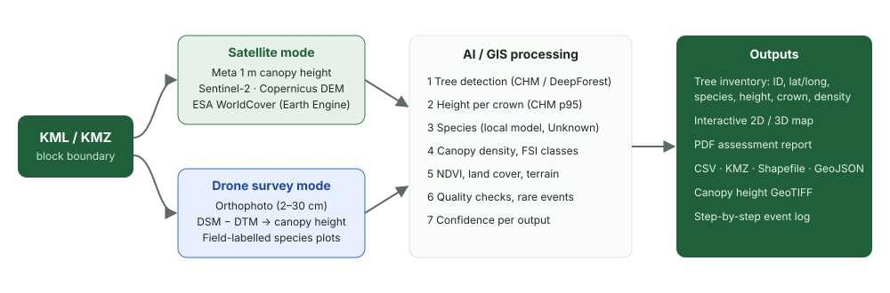

# Vandrishti AI

**AI/ML GIS tree inventory for forest clearance: upload a KML boundary, get a georeferenced tree inventory.**

Before forest land is diverted for mining, every tree in the block has to be enumerated with species, height,
crown and canopy density. Today that is a manual field survey. Vandrishti automates the first pass: the user
uploads the lease or diversion boundary as KML/KMZ, the system fetches the data for exactly that area, detects
and measures trees, and produces a tree inventory, maps and a report, showing every processing step and every
problem it met along the way.



## Two modes, one pipeline

| | **Satellite mode** | **Drone survey mode** |
|---|---|---|
| Input | KML / KMZ boundary only | Boundary + orthophoto (+ DSM/DTM or CHM) |
| Data | Meta/WRI 1 m canopy height, Sentinel-2, Copernicus DEM, ESA WorldCover (Google Earth Engine) | Survey imagery and height models, plus the satellite layers for context |
| Trees | Tree tops + crowns from canopy height (resolvable crowns; count range for closed canopy) | Individual crowns by DeepForest on 10 cm imagery |
| Height | Satellite canopy height (±3–6 m) | Survey canopy height model (DSM − DTM) |
| Species | Not available (stand-level forest class only) | Local species model trained on field-labelled trees |
| Density | Forest Survey of India classes (VDF/MDF/OF) on a 25 m grid | Same |
| Cost per run | Free, minutes | Drone flight + processing |

Both modes produce the same outputs: a tree inventory (CSV, GeoJSON, KMZ for Google Earth, Shapefile for
QGIS/ArcGIS), a canopy height GeoTIFF, a PDF assessment report, and an interactive map with 3D view.

## Validation

Methods are validated on the IDTReeS benchmark (NEON aerial imagery, airborne LiDAR and field data):
satellite density classes match airborne LiDAR on 77 % of 529 plots (97 % within one class), and survey-mode
crown detection finds 52 % of 1,765 hand-delineated crowns with heights within ±4 m. See
[results/idtrees/validation.md](results/idtrees/validation.md) and
[results/idtrees/satellite_vs_lidar.md](results/idtrees/satellite_vs_lidar.md) for all results and caveats.

## Run it

Requirements: Python 3.11–3.13, Node 18+, a Google Cloud project registered for Earth Engine.

```bash
# 1. Backend
python -m venv .venv
.venv/Scripts/activate            # Windows  (Linux/macOS: source .venv/bin/activate)
pip install -r backend/requirements.txt
pip install deepforest            # drone survey mode (installs PyTorch, CPU is fine)
earthengine authenticate          # once per machine
cp .env.example .env              # set GEE_PROJECT=<your project id>

# 2. Frontend
cd frontend && npm install && npm run build && cd ..

# 3. Start (serves the API and the built dashboard)
cd backend && uvicorn vandrishti.api:app --port 8000
```

Open http://localhost:8000 and run one of the sample boundaries near Chandrapur, or a sample drone survey.
Downloaded data is cached per area in `data/cache/`, so a block that has run once runs again without internet.

For frontend development, run `npm run dev` in `frontend/` (port 5173, proxies `/api` to port 8000).

Tests: `cd backend && pytest`.

## Repository layout

```
backend/vandrishti/
  api.py               HTTP API: create assessments, follow progress, download results
  pipeline.py          Satellite mode stages (and shared density / quality / inventory stages)
  pipeline_survey.py   Drone survey mode stages
  aoi.py               Safe KML / KMZ / GeoJSON parsing and validation
  jobs.py              File-backed job state, stage progress and event log
  sources/gee.py       Earth Engine data access (chunked, cached downloads)
  processing/          Tree detection, density, vegetation, survey inputs, species, rendering
  exports.py report.py CSV / KMZ / Shapefile exports and PDF report
frontend/              React + MapLibre dashboard
training/              Train a local species model from field-labelled trees
validation/            IDTReeS benchmark validation
samples/               Sample boundaries (Chandrapur) and sample surveys (NEON / IDTReeS)
docs/                  SOP, drone data specification, architecture and deployment, methodology
```

## Documentation

New to the project? Start with **[docs/GUIDE.md](docs/GUIDE.md)** (concepts from zero, how a run works,
accuracy, limitations). The full reading order is in [docs/README.md](docs/README.md).

- [Complete guide](docs/GUIDE.md): start here
- [FAQ and demo script](docs/FAQ.md): likely questions with answers
- [Presentation evidence pack](presentation/README.md): key numbers and proof for every claim
- [Standard operating procedure](docs/SOP.md): how a WCL team runs an assessment
- [Drone survey data specification](docs/drone_survey_spec.md): what to fly and deliver
- [Architecture, deployment and cost](docs/architecture.md)
- [Methodology, rare events and limitations](docs/methodology.md)

## Data sources and licences

Meta/WRI Global Canopy Height (CC BY 4.0, Tolan et al. 2024) · Sentinel-2 and Copernicus DEM (contains
modified Copernicus data) · ESA WorldCover (CC BY 4.0) · DeepForest (MIT, Weinstein et al.) · IDTReeS / NEON
benchmark data (NEON, CC BY 4.0) · Basemap imagery © Esri, Maxar, Earthstar Geographics.
