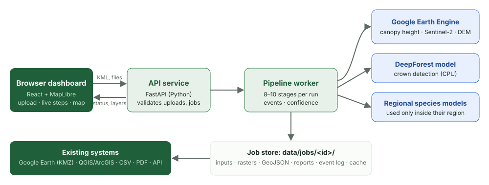

# Architecture, deployment and integration

## System architecture

| Component | Technology | Responsibility |
|---|---|---|
| Dashboard | React, MapLibre GL | Upload, live stage progress and event log, 2D/3D map, statistics, tree table, exports |
| API | FastAPI (Python) | Validates uploads, creates jobs, serves status and registered outputs only |
| Pipeline worker | NumPy, SciPy, scikit-image, rasterio, shapely | Stages: boundary → data → trees → species → density → vegetation → quality → inventory |
| Data access | Earth Engine API | Requests pixels on the block's UTM grid; chunked downloads; on-disk cache |
| Crown detection | DeepForest (RetinaNet, PyTorch, CPU) | Tiled prediction with overlap and duplicate removal |
| Species | scikit-learn Random Forest | Region-tagged models; confidence threshold → Unknown |
| Job store | Files per job (`data/jobs/<id>/`) | Inputs, outputs, `job.json` state, `events.jsonl` log: auditable and easy to archive |

Design choices:

- **Every stage reports**: a summary, metrics, a preview image and events with the action taken. Recoverable
  problems (clouds, missing DTM, partial coverage) never stop the run; they are logged and handled.
- **Metric-correct GIS**: all rasters are fetched onto the block's own UTM grid, so areas, crown sizes and
  distances are computed in metres, then transformed to WGS84 only for display and export.
- **No silent guessing**: species below the confidence threshold are *Unknown*; a species model is only used
  inside the region it was trained on; satellite-derived heights in survey mode are flagged.

## Deployment options

| Option | Hardware | Suits |
|---|---|---|
| Single workstation / laptop | 4+ cores, 16 GB RAM, no GPU needed | Pilot, demonstrations, one area office |
| On-premise server (area / HQ) | 8–16 cores, 32 GB RAM, optional GPU | Several users; drone mosaics of many km² |
| Cloud VM | Same as server | Access from multiple subsidiaries |

A GPU only speeds up DeepForest on large drone mosaics; satellite mode is CPU-bound and fast.

Measured on a laptop CPU during development:
- Satellite mode, 1.2 km² block: about 15–60 s (the first run downloads data; repeat runs use the cache).
- Drone survey mode, 20 m × 20 m plot: about 30–60 s, including satellite context layers. Time grows roughly
  with orthophoto area.

## Minimum-cost site deployment

| Item | Satellite mode | Drone survey mode |
|---|---|---|
| Imagery and height data | Free (Meta/WRI, Copernicus, ESA via Earth Engine, non-commercial tier) | Drone survey per block (contractor quote) |
| Software licences | None (open-source stack) | None; OpenDroneMap is free, Pix4D/Metashape optional |
| Compute | Existing office PC | Existing PC; server for large mosaics |
| Field effort | Verification of flagged trees only | Sample plots once per region for the species model |

The lowest-cost path is to run **satellite mode for every block** (screening, Stage-I figures, density maps)
and commission **drone surveys only for blocks going to Stage-II** or needing species, reusing the regional
species model across blocks.

Earth Engine: the project is registered for non-commercial use. An operational deployment by a company should
review the Earth Engine commercial terms, or switch the data layer to the same datasets from open buckets
(Meta canopy height and Copernicus data are also published on AWS Open Data).

## Integration with existing systems

- **Files**: KMZ (Google Earth), Shapefile (QGIS/ArcGIS), CSV (spreadsheets, ERP), GeoTIFF, PDF.
- **API**: `POST /api/jobs` (boundary), `POST /api/jobs/survey` (boundary + survey rasters),
  `GET /api/jobs/{id}` (status, stages, events), `GET /api/jobs/{id}/files/{name}` (outputs). Other systems can
  submit blocks and fetch results programmatically.
- **Coordinate systems**: inputs in any georeferenced CRS; outputs in WGS84, with metric calculations in UTM.

## Security

- Uploads: file-type allow-list, size limits, hardened XML parsing (no external entities), KMZ zip-bomb limits.
- Only files a job registered as outputs can be downloaded; identifiers are validated against path traversal.
- No credentials in the repository; the Earth Engine project is configured through `.env`.
- For multi-user deployment, add organisation single sign-on in front of the API (reverse proxy).
